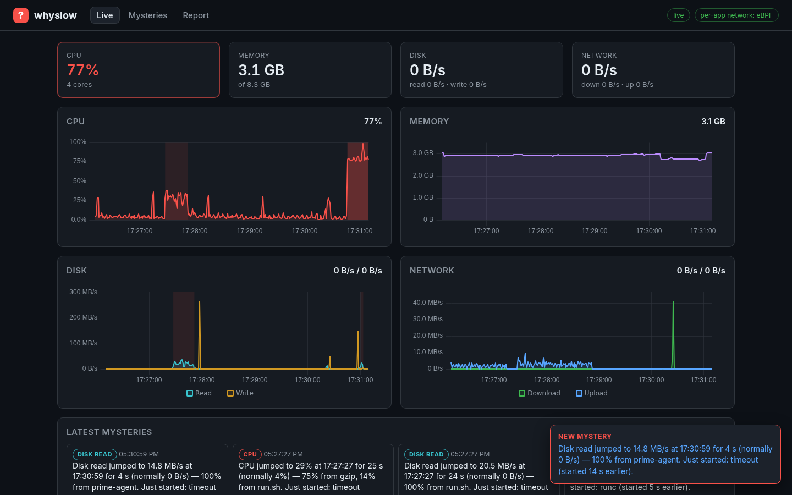
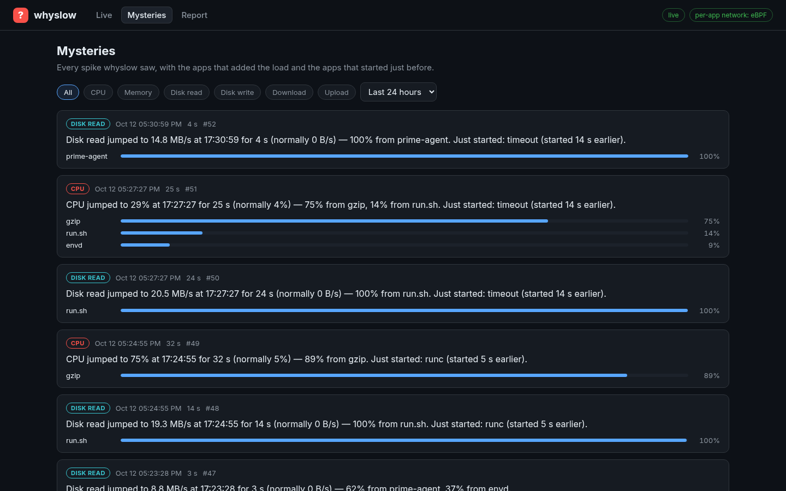
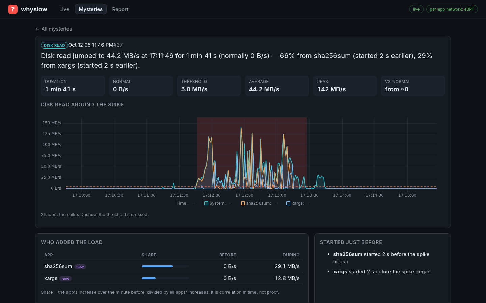
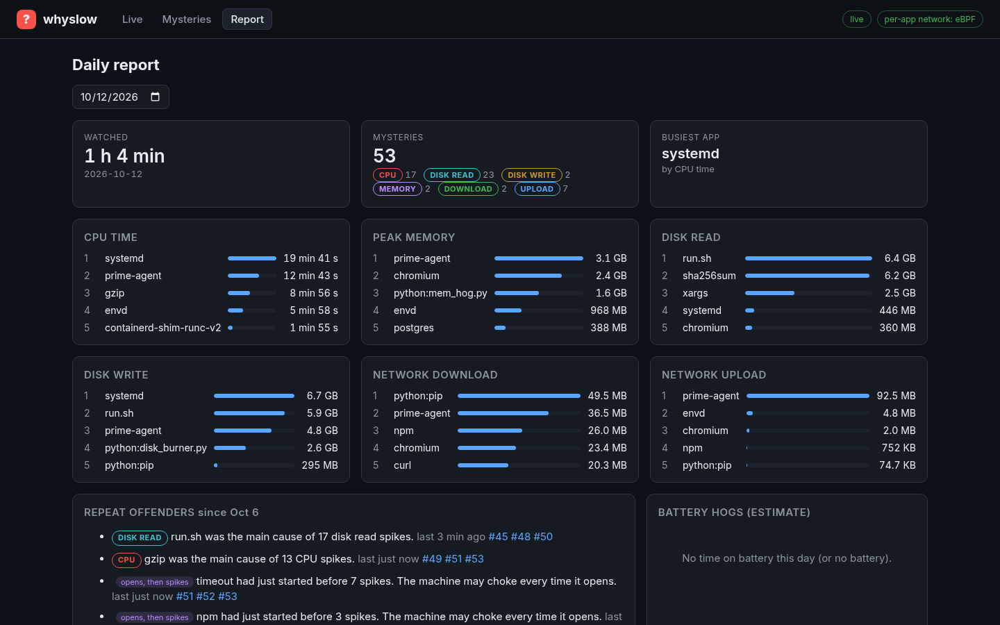
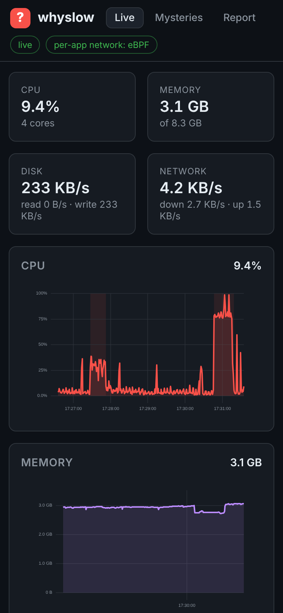
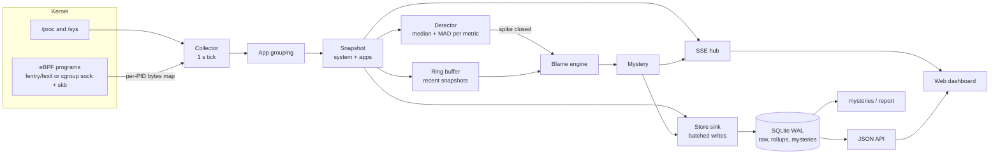

# whyslow

**Find out why your Linux machine is slow.** whyslow watches CPU, memory, disk I/O, network, battery and temperature every second, for the whole system and for every app. When something spikes, it works out which app added the load and which app started just before, and writes it down in one plain sentence:

> Disk write spiked 4.2x at 15:12:04 for 38 s — 81% from chrome (started 6 s earlier), 17% from dockerd.

Task managers show what is busy *now*. The slowdown you noticed five minutes ago is gone by the time you open one. whyslow keeps the timeline, catches the spike while it happens, and leaves you a record of each one (a "mystery") to read later. It is a single static Go binary with an embedded web dashboard, a terminal view and a SQLite history.



| Mysteries feed | One mystery |
|---|---|
|  |  |

| Daily report | Phone width |
|---|---|
|  |  |

All screenshots are from a real run on a 4 vCPU Debian 12 VM (kernel 6.1) with `sudo whyslow run --ebpf`, while a script made CPU (`gzip`), disk writes and network (`curl`) spikes.

## Features

- **Collector**: every second reads `/proc/[pid]/stat`, `status`, `io`, plus `/proc/stat`, `/proc/meminfo`, `/proc/diskstats`, `/proc/net/dev`, `/sys/class/power_supply` and `/sys/class/thermal`. Missing battery or sensors are handled, not errors.
- **App grouping**: processes become the apps people recognise. Every chrome renderer is `chrome`; a compiler's short-lived children count for the build that started them; launchers (shells, terminals, systemd, sudo, `timeout`, container shims) do not swallow their children.
- **Per-app network with eBPF**: bytes charged to the process that owns the socket. Falls back to system-level network plus per-app socket counts when eBPF is unavailable.
- **Spike detection**: per metric rolling median + MAD with sustain, hysteresis and cooldown.
- **Blame engine**: ranks apps by how much they *added* during the spike, flags newcomers, writes the sentence.
- **Battery hogs** (labelled as an estimate) and **repeat offenders** ("pip opens, then disk spikes", seven-day look-back).
- **Storage**: SQLite in WAL mode through a pure-Go driver (no CGO), batched writes, minute rollups and retention.
- **Dashboard**: Live / Mysteries / Report pages over Server-Sent Events, uPlot charts, dark and responsive, embedded in the binary.
- **CLI**: `run`, `top`, `mysteries`, `report`, `doctor`.

## Architecture



One goroutine owns the tick. Each snapshot fans out to the detectors, a ring buffer of recent snapshots, the store sink and the live hub; a slow browser or a slow disk cannot stall collection (the hub drops frames for slow clients, the sink batches).

## How spike detection works

Each metric (CPU, memory, disk read, disk write, network rx, network tx) has its own detector holding the last 120 one-second samples. The threshold is

```
max(median + 6 × 1.4826 × MAD,  ratio × median,  median + minimum jump,  floor)
```

- **Median + MAD**, not mean + standard deviation: one huge spike in the window barely moves the median, so the baseline does not chase the spike it is supposed to catch. 1.4826 × MAD matches the standard deviation for normal data.
- **Ratio, minimum jump and floor** stop noise from counting. Idle disk has a median of 0 B/s, so without a floor a 40 KB write would be "infinitely" above normal. Disk uses 3x and 5 MB/s, network 3x and 1 MB/s, CPU 2x and +20 points with a 25% floor (capped at 90% so a busy baseline cannot push it out of reach), memory a jump of at least 512 MB or 10% of RAM.
- **Warm-up**: nothing is reported in the first 60 s.
- **Sustain**: a spike opens only after 3 consecutive samples above the threshold.
- **Hysteresis**: it closes after 5 samples below 80% of the threshold, so a load that wobbles around the line stays one spike instead of ten.
- **Cooldown**: 30 s after a spike closes, the same metric cannot open another. Spikes are cut at 10 minutes.
- The baseline is frozen while a spike is open, so a long spike does not become the new normal.

## How blame works

For every app, the blame engine compares its mean during the spike with its mean over the 60 s before it (ending 5 s before onset, so the ramp-up does not count as "before"). Only increases count. Each app's share is its increase divided by the sum of all increases. Apps under 5% are dropped and at most 5 are listed. Apps started up to 15 s before onset are flagged as newcomers, because "chrome started 6 s earlier" is often the more useful clue.

**Worked example** (this is a unit test, `internal/blame/blame_test.go`): disk write is normally 3.0 MB/s and jumps to a mean of 12.6 MB/s for 38 s from 15:12:04.

| App | Before (MB/s) | During (MB/s) | Increase | Share |
|---|---|---|---|---|
| chrome (started 15:11:58, wrote 30 MB in its first second) | 0.5 | 8.3 | 7.8 | **81%** |
| dockerd | 1.0 | 2.6 | 1.6 | **17%** |
| systemd-journald | 0.3 | 0.5 | 0.2 | 2% (dropped) |

Total increase 9.6 MB/s, so chrome gets 7.8 / 9.6 = 81% and dockerd 17%. The result is the sentence at the top of this page. This is correlation in time, not proof of cause; whyslow says what moved together and what started first, and leaves the verdict to you.

## eBPF: per-app network

`/proc` has no per-process network counters, so per-app network needs the kernel's help. whyslow uses [cilium/ebpf](https://github.com/cilium/ebpf) with programs written with its assembler (no clang needed to build) and has two modes. `whyslow run --ebpf` tries them in order and logs which one is active.

1. **fentry/fexit** on `tcp_sendmsg`, `tcp_cleanup_rbuf`, `udp_sendmsg`, `udp_recvmsg` and their IPv6 UDP twins. Bytes go into an LRU hash map keyed by PID. The offset of the byte-count argument is looked up in the kernel's BTF and its type is checked, so the program fails loudly instead of reading the wrong slot.
2. **Socket-owner mode** (fallback): a `cgroup/sock_create` program records which process opened each socket (socket cookie → PID), and cgroup skb ingress/egress programs on the root cgroup charge every packet's length to that owner. This needs cgroup v2 but no JIT.

**What was verified on a real kernel** (Debian 12, kernel 6.1.158, 4 vCPU VM):

- **Socket-owner mode works.** The root-only test (`make ebpf-test`) downloads 5 MiB and uploads 1 MiB with curl from a local server: rx 5,329,058 B and tx 1,114,050 B were charged to `curl`. In a live `sudo whyslow run --ebpf`, three 40 MB downloads from the internet charged **120,563,939 B to `curl`, out of 121,297,010 B received on the whole interface (99.4%)**.
- **fentry/fexit could not be loaded on this machine.** The VM's kernel is built without the BPF JIT, and fentry programs need a JIT-compiled trampoline; even an empty fentry program fails with ENOMEM. That is why the fallback exists. The fentry path is covered by unit tests (bytecode shape, BTF slot lookup and type checks) but **has not been run on a live kernel**. `whyslow doctor` reports the JIT state.
- **MPTCP**: Go 1.24+ listeners accept MPTCP by default, and MPTCP subflow sockets are created by the kernel, not by a process, so socket-owner mode cannot attribute them. whyslow's own HTTP listener therefore uses plain TCP.

Without root or without eBPF, whyslow shows system-level network from `/proc/net/dev` and, per app, the number of open sockets from `/proc/[pid]/fd`. Network spikes are still detected; the mystery then says per-app network needs eBPF instead of guessing.

## Measured overhead

Measured on the same VM, 4 vCPU, kernel 6.1, `sudo whyslow run --ebpf` at the default 1 s interval, sampled every 5 s for 595 s (120 samples) while the spike script ran:

| | Average | Median | Max |
|---|---|---|---|
| CPU (percent of one core) | 1.17% | 1.2% | 2.2% (5 s window) |
| RSS | — | 22.8 MB | 24.5 MB (min 19.7 MB) |

These numbers are from one machine; a box with thousands of processes will cost more.

## Install and run

Requirements: Linux, Go 1.26+ to build. Root is optional (needed for other users' disk I/O and for eBPF).

```sh
git clone https://github.com/Darshan-dev57/whyslow
cd whyslow
make build                    # CGO_ENABLED=0, static binary ./whyslow
./whyslow doctor              # what this machine supports
sudo ./whyslow run --ebpf     # dashboard on http://127.0.0.1:7777
```

The database defaults to `~/.local/share/whyslow/whyslow.db` (`--db` to change). The dashboard binds to localhost by default and checks the Host header.

## CLI

```text
whyslow run [--addr 127.0.0.1:7777] [--db PATH] [--ebpf] [--interval 1s] [-v]
    collector, detector, storage and dashboard in one process
whyslow top [--ebpf] [--n 15] [--once]
    terminal view of the busiest apps, no database needed
whyslow mysteries [--since 24h] [--limit N] [--db PATH]
    the mysteries feed
whyslow report [--today | --date YYYY-MM-DD] [--json] [--db PATH]
    top apps per resource, battery hogs, repeat offenders, coverage
whyslow doctor
    kernel, BTF, hooks, JIT, cgroup v2, battery, sensors, privileges
```

## Storage

Raw system samples are kept 24 h and per-app samples 6 h; both are rolled up into one-minute rows kept for 30 days. Charts over long ranges read the rollups, so a week never means hundreds of thousands of points. Writes are batched in one transaction per flush, and SQLite runs in WAL mode so the dashboard can read while the collector writes.

## Tests

```sh
make test          # unit tests: parsers on fixture /proc trees, detector cases, blame worked example, grouping, store, HTTP handlers
make race          # same with -race
make integration   # starts a real CPU + disk burner and asserts a mystery blames it
make ebpf-test     # root only: loads the eBPF programs and checks curl's bytes
make lint          # gofmt, go vet, staticcheck
```

CI (GitHub Actions) runs gofmt, vet, staticcheck, race tests, the build, the burner integration test and the root eBPF job.

## Limits

- Blame is correlation in time, not causation.
- Without root, other users' processes hide `/proc/[pid]/io`, so their disk I/O is invisible (`doctor` says how many).
- Battery hogs are an estimate: there is no per-app energy counter, so each window's drain is split by an activity score dominated by CPU time. The screen, radio and GPU belong to no app. Battery and thermal code is tested with fixtures only; the VM used for development has neither.
- fentry/fexit mode is unit-tested but has not been loaded on a live kernel (see above). Socket-owner mode cannot attribute MPTCP subflows.
- Processes that start and exit between two ticks are only visible through the parent they credit their work to.
- GPU usage is not tracked.
- Linux only.

Design decisions and deviations from the original plan are in [docs/DECISIONS.md](docs/DECISIONS.md).

## License

MIT
